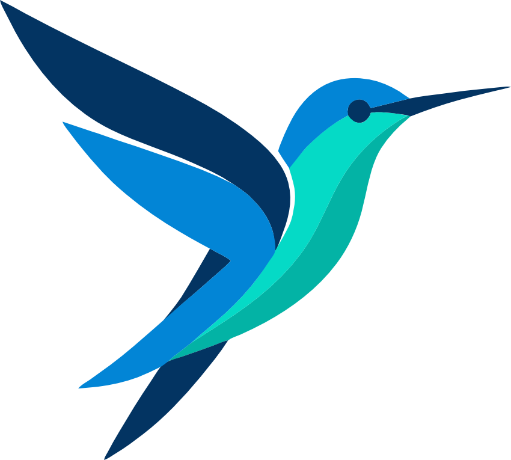

<div align="center">

  

  <h1>Bird IDE</h1>

  <p><b>A community-driven, fully native, cross-platform IDE for Flutter development — written in Flutter itself.</b></p>
  <p><b>⚡ Zero WebViews • Zero Monaco • Zero Electron ⚡</b></p>

  <p>
    <a href="#-overview">Overview</a> •
    <a href="#-key-features">Key Features</a> •
    <a href="#-tech-stack">Tech Stack</a> •
    <a href="#-getting-started">Getting Started</a> •
    <a href="#-roadmap">Roadmap</a> •
    <a href="#-contributing">Contributing</a> •
    <a href="#-license">License</a>
  </p>

[](LICENSE)
[](https://dart.dev)
[](#)
[](#-contributing)

</div>

---

## 🚧 Status

**Bird IDE is under active development.** It is not stable yet — features are
incomplete, APIs move, and things break. Try it, but do not rely on it for daily
work.

**Want to help?** Read **[CONTRIBUTING.md](CONTRIBUTING.md)** — it covers setup,
workflow, and good first issues. The project conventions live in
[AGENTS.md](AGENTS.md).

---

## 🚀 Overview

**Bird IDE** is a modern, lightweight, and blazingly fast Integrated Development Environment designed specifically for Flutter developers.

Unlike traditional IDEs that rely on memory-heavy web shells (Electron), web code editors (Monaco), or embedded WebViews, **Bird IDE is 100% native**. Built completely in **Flutter**, Bird delivers pixel-perfect UI, smooth high-frame-rate performance, and minimal memory footprint across macOS, Linux, and Windows.

---

## ✨ Key Features

- 🏎️ **100% Native Performance**: Built natively with Flutter desktop without Electron, WebViews, or DOM overhead.
- 🌌 **Sky**: Open files as nodes on an infinite canvas — pan, pinch to zoom, double-click a header to frame a node. Only the focused node is a live editor, so a canvas full of files stays smooth. Prefer tabs? Switch to the traditional layout in Settings.
- 🦅 **Hawk**: One search box at the top of the window, on `Cmd/Ctrl+K`. Fuzzy file search today, built to take more kinds of results.
- 🔎 **Project Search**: Full-text search across the project, powered by a bundled [ripgrep](https://github.com/BurntSushi/ripgrep) via [`dart_ripgrep`](https://pub.dev/packages/dart_ripgrep). Results open at the matching line.
- 📦 **pub.dev Packages**: Search pub.dev, read a package's README, changelog, example and versions, and add, upgrade or remove dependencies without leaving the IDE.
- ⚡ **Dart Language Server Protocol (LSP)**: Full integration with `dart language-server` for real-time code completion, signature help, hover documentation popups, and diagnostics.
- 📝 **Advanced Code Editor**: Powered by [`code_forge`](https://pub.dev/packages/code_forge) and [`re_highlight`](https://pub.dev/packages/re_highlight) with the Fira Code font and re_highlight's themes (`vs2015` by default).
- 💻 **Integrated Terminal**: Embedded PTY terminal (`xterm` + `flutter_pty`) allowing native shell execution, running `flutter run`, and executing CLI commands directly inside the IDE.
- 📁 **File Explorer**: A lazily loaded tree with file type icons; files matched by `.gitignore` are dimmed.
- 🎨 **Theme Engine & Dynamic Layouts**: Customizable dark/light UI themes, flexible pane splitters (`panes`), and custom titlebars.
- 🔌 **Extensible Design**: Architecture prepared for plugins and community extensions.
- ⌨️ **Shortcuts**: `Cmd/Ctrl+K` for Hawk, `Cmd/Ctrl+S` to save, `Cmd/Ctrl+O` to open a folder and `Cmd/Ctrl+,` for settings — all declared in one registry and listed in the Keymap.

---

## 🛠️ Tech Stack

| Component            | Technology / Library                                                                                                                                                  |
| :------------------- | :-------------------------------------------------------------------------------------------------------------------------------------------------------------------- |
| **Framework**        | [Flutter Desktop](https://flutter.dev) (stable)                                                                                                                       |
| **Language**         | [Dart](https://dart.dev) (`^3.13.2`)                                                                                                                                  |
| **Language Server**  | [Dart LSP](https://dart.dev) (`dart language-server`) via `LspStdioConfig`                                                                                            |
| **Editor Core**      | [`code_forge`](https://pub.dev/packages/code_forge) & [`re_highlight`](https://pub.dev/packages/re_highlight)                                                         |
| **Typography**       | [Fira Code](https://github.com/tonsky/FiraCode)                                                                                                                       |
| **Terminal**         | [`xterm`](https://pub.dev/packages/xterm) & [`flutter_pty`](https://pub.dev/packages/flutter_pty)                                                                     |
| **State Management** | [`provider`](https://pub.dev/packages/provider) (`ChangeNotifierProxyProvider`)                                                                                       |
| **Window & Layout**  | [`window_manager`](https://pub.dev/packages/window_manager) & [`panes`](https://pub.dev/packages/panes)                                                               |
| **Search**           | [`dart_ripgrep`](https://pub.dev/packages/dart_ripgrep) (a bundled [ripgrep](https://github.com/BurntSushi/ripgrep))                                                 |
| **Package pages**    | [`flutter_markdown_plus`](https://pub.dev/packages/flutter_markdown_plus), [`markdown`](https://pub.dev/packages/markdown), [`html`](https://pub.dev/packages/html), [`url_launcher`](https://pub.dev/packages/url_launcher) |
| **Icons & Media**    | Nerd Font glyphs, [`flutter_svg`](https://pub.dev/packages/flutter_svg)                                                                                               |

---

## 🚦 Getting Started

### Prerequisites

Ensure you have the following installed on your machine:

- [Flutter SDK](https://docs.flutter.dev/get-started/install), a stable release with Dart `3.13.2` or newer
- Desktop build tools (Xcode for macOS, Visual Studio C++ for Windows, or build essentials / `clang` / `cmake` for Linux)

### Installation & Execution

1. **Clone the repository:**

   ```bash
   git clone https://github.com/yakupkahraman/bird.git
   cd bird
   ```

2. **Install dependencies:**

   ```bash
   flutter pub get
   ```

3. **Run Bird IDE locally:**

   ```bash
   # macOS
   flutter run -d macos

   # Linux
   flutter run -d linux

   # Windows
   flutter run -d windows
   ```

---

## 🗺️ Roadmap

- [x] **Flutter LSP Integration**: Full Language Server Protocol support for Dart/Flutter auto-complete, signature help, hover documentation & diagnostics.
- [x] **Bundled Flutter SDK Management**: Built-in Flutter SDK version management, channel switching, and automated SDK setup.
- [x] **pub.dev Integration**: In-editor package search, version inspection, and one-click dependency management for `pubspec.yaml`.
- [ ] **Debugger Suite**: Built-in breakpoints, call stack inspection, and Dart DevTools integration.
- [ ] **Git Version Control Pane**: Visual diff viewer, branch switcher, and inline git status markers.
- [ ] **Device & Emulator Management**: In-editor device selector, emulator/simulator launching, and wireless debugging support.
- [ ] **Extension Marketplace**: Community plugin system for custom themes, keybindings, and extensions.

---

## 🤝 Contributing

Bird is community-driven and early — this is the best time to shape it. Bug
reports, fixes, features, docs and design are all **greatly appreciated**.

Start with **[CONTRIBUTING.md](CONTRIBUTING.md)** for setup, workflow and good
first issues, and see **[AGENTS.md](AGENTS.md)** for the code conventions that
keep the project readable.

---

## 📄 License

Distributed under the **GNU General Public License v3.0**. See [`LICENSE`](LICENSE) for details.

---

<div align="center">
  <sub>Built with ❤️ by Yakup Kahraman and the Flutter Community.</sub>
  <br>
  <sub>Bird logo designed by me btw :)</sub>
</div>
